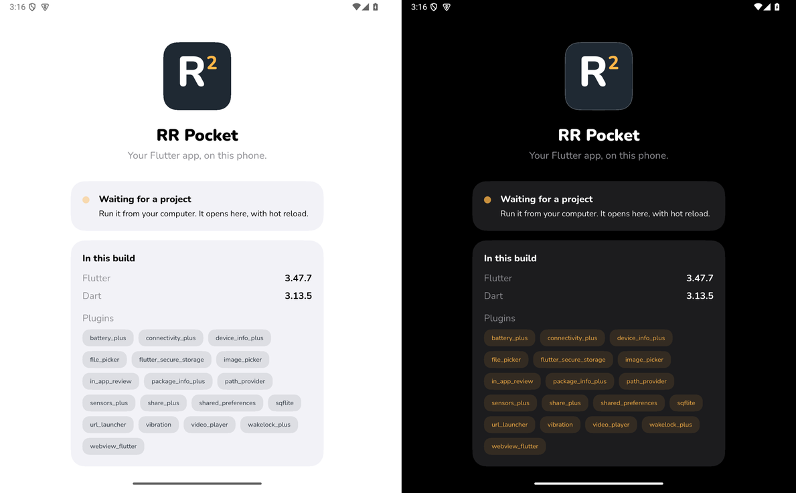

# RR Pocket

Run your Flutter app on your Android phone with just the Flutter SDK. No
Android SDK, no adb, no Gradle build. Like Expo Go, for Flutter.

RR is Raccoon Runtime, and r and R: Flutter's hot reload and hot restart keys.



RR Pocket is an Android app with Flutter's debug engine and a set of plugins
built in. `flutter run -d pocket` compiles your project and sends it over
Wi-Fi; the app restarts into it. Hot reload works as usual.

Private for now. Design and decisions: note 025 in `project_raccoon`.

## Status

Works on the Android emulator (Flutter 3.47.7, 2026-10-24):

- **`flutter run -d pocket` over the network, no adb.** A project with no
  `android/` folder launches in 4.7-6.6 s (build, upload, start); hot reload
  0.34-0.50 s, hot restart 1.0-1.1 s; its `print` output shows in
  `flutter run`; quitting returns the phone to RR Pocket's screen.
- All 29 plugins the app carries answer, with no change to the project's
  code (`docs/plugins.md`). The arm64 APK is 92.5 MB.
- **The app ships non-debuggable, as Play requires, and the debug engine
  still runs.**

On a Pixel 7 (Android 16, 2026-10-25): run from Lumide over real Wi-Fi.
`flutter run -d pocket` of the probe, every plugin in one project, through
a USB port forward: launched in 11.0 s, its 30 checks answer (real
biometrics, both cameras, sensors), hot reload 0.40 s, hot restart 2.7 s
(a 116 MB kernel), quit 0.16 s; the trails demo hot restarts in 1.3 s.
Pairing found on the network, by QR link and typed; a project that throws
at startup shows its error instead of freezing.

## Build

```sh
tool/build_apk.sh          # arm64, for a phone
tool/build_apk.sh x64      # for the emulator
```

That writes `build/rr_pocket-<abi>.apk`, signed with the debug keystore, or
with yours when `RR_KEYSTORE`, `RR_KEYSTORE_PASS` and `RR_KEY_ALIAS` are set.
Flutter's Gradle plugin ties the engine to the debuggable flag, so the script
builds debug, then `tool/undebug_manifest.py` turns the flag off and the APK
is signed again. The home screen shows the Flutter version it stamps in.

## Use it

Install the `pocket` command:

```sh
dart pub global activate rr_pocket
```

Open RR Pocket on the phone, then on the computer, once:

```sh
pocket pair
```

It finds the phone on the network and the phone asks you to allow it. Where
the network hides the phone, it shows a QR code to scan with RR Pocket
instead; `pocket pair <address> <code>`, with what the phone shows, always
works. How each works: `docs/pairing.md`. Everything between the computer
and the phone is TLS, pinned to the phone's certificate when you pair
(`docs/wifi.md`, Security). Found or typed, it prints the certificate's
start, such as `2DC9 1E21`: check RR Pocket shows the same under its code.

That registers the `pocket` device with your Flutter SDK. Then, from any
project:

```sh
pocket pin              # match RR Pocket's plugin versions
flutter run -d pocket
```

When something doesn't run, `pocket doctor` in the project checks the
pairing, the Flutter version, the device and the project's plugins, and
says what to fix.

The same package is a Lumide plugin: Lumide loads it at its next start,
and RR Pocket shows in its device list after pairing. In Lumide, **RR Pocket:
Pair with Phone** and **RR Pocket: Match Plugin Versions** do the two steps
above (`desktop/README.md`).

The project's Flutter version must be RR Pocket's (the home screen says
which), and its plugins the versions RR Pocket carries; `flutter run` stops
with a message saying which when they aren't. A plugin RR Pocket lacks gets a
warning: calls to it throw `MissingPluginException`. How it works:
`docs/wifi.md`.

`probe/` is a project that calls every bundled plugin and logs
`PROBE <plugin> ok …` or `MISSING`. After changing the plugin set, install
the new APK and run `tool/run_probe.sh`; it fails on any `MISSING`.

## Layout

- `app/`: the Android app, built with `sofluffy_ui` (pinned to the commit
  Lumide uses). Its Flutter plugins are the ones in `pubspec.yaml`; a test
  keeps the home screen's list in step.
- `app/fonts/`: Nunito, cut to static weights from Google Fonts' variable
  font (SIL Open Font License, `OFL.txt`).
- `branding/`: the icon and the README's screenshot.
- `site/`: the website (React, Vite and Tailwind, as lumide-landing): a
  landing page, the docs and the privacy policy Play links to. `npm run
  build` writes static files to `site/dist/` to host anywhere. Its fonts
  and pictures are copies from `app/fonts/` and `branding/`.
- `store/`: the Play listing (`listing.md`), the privacy policy's text, the
  graphics (`play/`), and the demo app they show (`demo/`). Remake the
  graphics with `tool/capture_store_screens.py` (a paired emulator or phone)
  then `tool/make_store_assets.py`.
- `tool/build_aab.sh`: the Play bundle, debug engine, not debuggable.
- `.github/workflows/deploy_google_play.yml`: builds, tests and uploads to
  Play (from Media Converter Ultimate's workflow; secrets listed at its
  top).
- `tool/build_apk.sh`: the build above.
- `tool/check.sh`: every check that needs no phone (analysis, Flutter
  tests, Kotlin tests for the pairing code and the control server).
- `tool/make_icons.py`: draws the R² launcher icons from Nunito ExtraBold
  (needs Pillow).
- `probe/`, `tool/run_probe.sh`: calls every bundled plugin, to check a build.
- `docs/plugins.md`: which plugins to bundle and why, and what Tier 1 cost.
- `tool/pin_plugins.py`: `pocket pin` from this checkout, without a
  phone (used for `probe/`).
- `app/android/.../pocket/`: the Kotlin side a computer talks to: the
  pairing code, the control server, the VM service relay.
- `desktop/`: the computer's side, the `rr_pocket` package: the `pocket`
  command behind the `pocket` device, and the Lumide plugin. From a
  checkout: `dart pub global activate --source path desktop`, or in Lumide,
  Plugins → Load Local Plugin → `desktop/`.
- `docs/wifi.md`: how `flutter run -d pocket` works, and what it took.
- `tool/drive_attach.py`: the adb-based spike driver: attaches from a
  project, restarts into it, edits, hot reloads, and times both.
